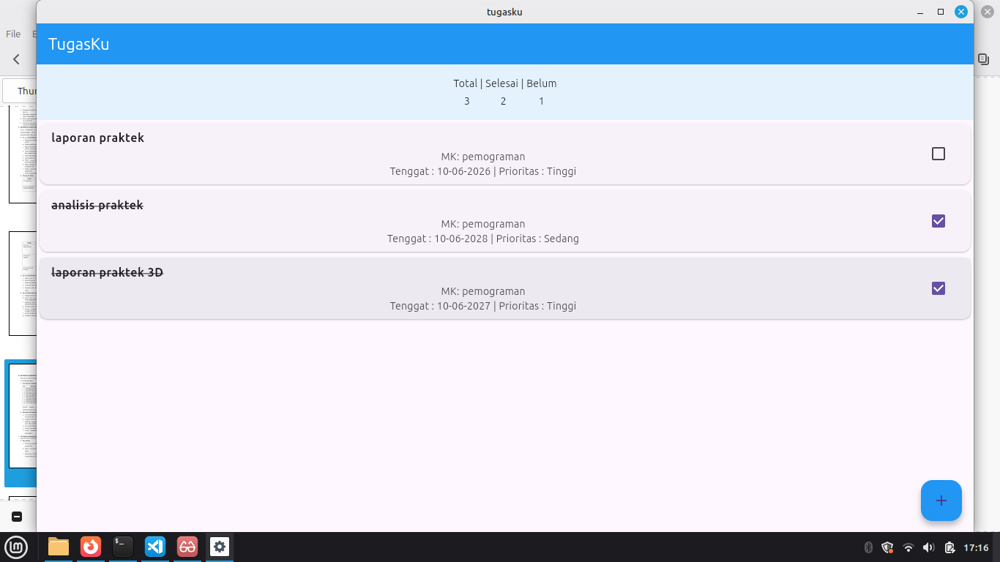
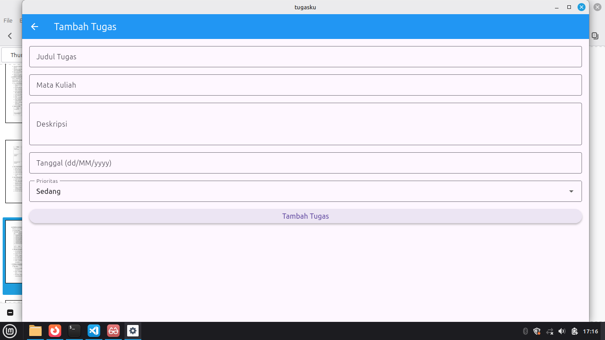
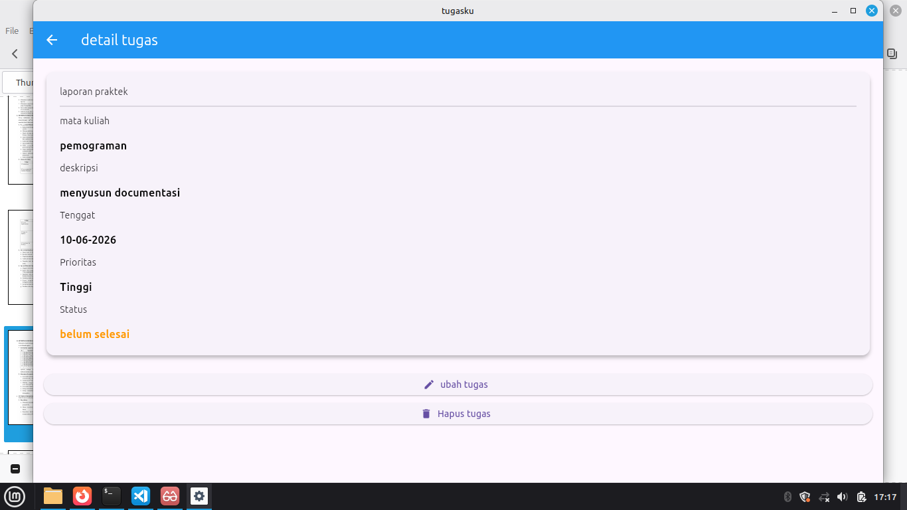
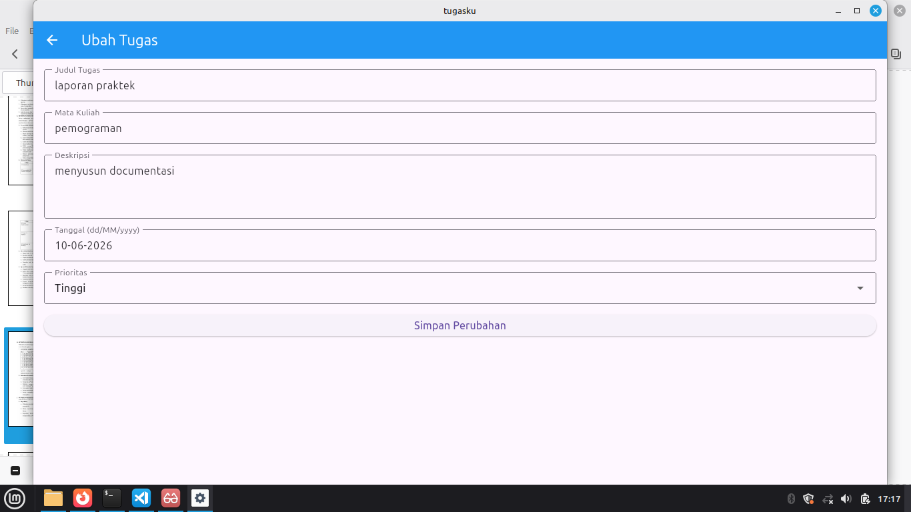
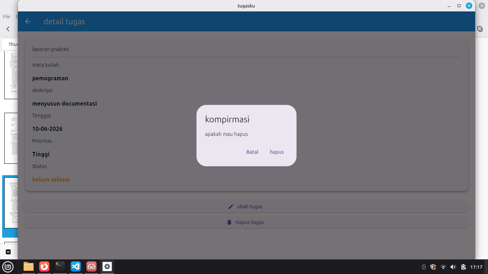
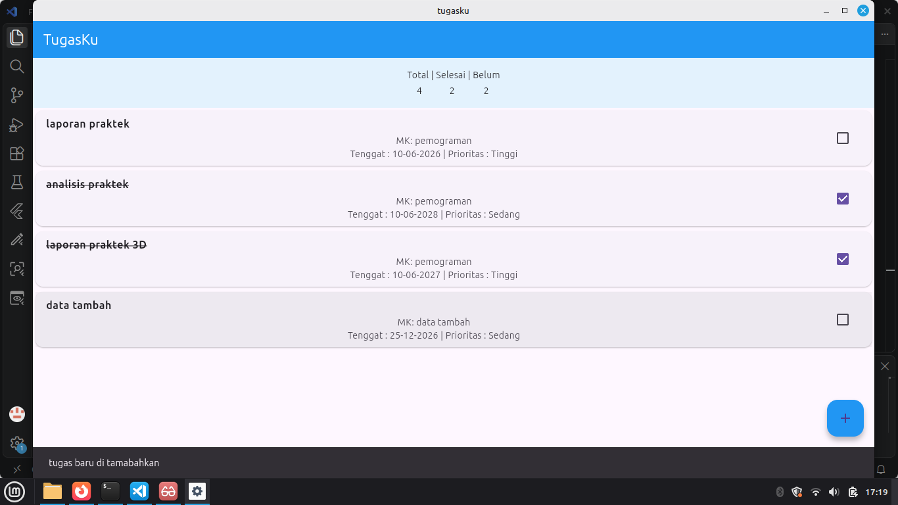
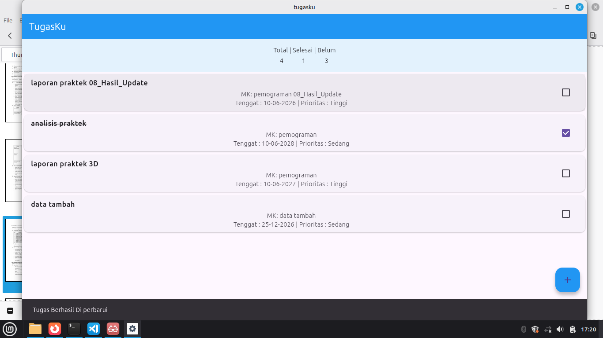
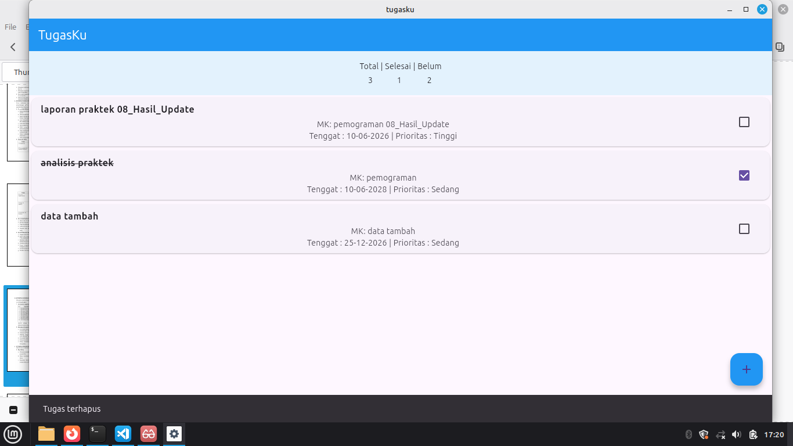
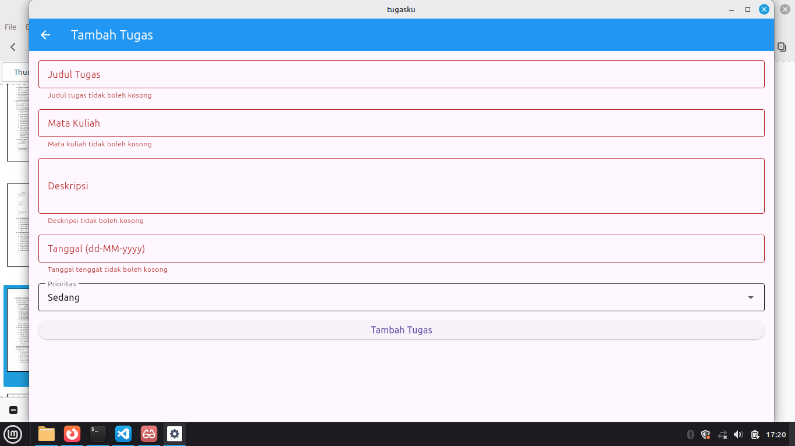

# TugasKu - Aplikasi Pencatat Tugas dan Tenggat Kuliah Berbasis Flutter

**TugasKu** adalah aplikasi mobile Android berbasis Flutter yang dikembangkan untuk memenuhi tugas Ujian Tengah Semester (UTS) mata kuliah **Pemrograman Mobile**. Aplikasi ini dirancang untuk membantu mahasiswa mencatat, memantau, memperbarui, dan mengelola daftar tugas perkuliahan beserta tenggat waktu dan tingkat prioritasnya secara terpusat agar tidak ada jadwal pengumpulan tugas yang terlewat.

---

## 👤 Identitas Pengembang

- **Nama Mahasiswa:** Aris Riswanto
- **NIM:** C2483207002
- **Program Studi:** Pendidikan Teknologi Informasi
- **Fakultas:** Fakultas Keguruan dan Ilmu Pendidikan (FKIP)
- **Institusi:** Universitas Muhammadiyah Tasikmalaya (UMTAS)
- **Mata Kuliah:** Pemrograman Mobile (Kode: FKIP08201A)
- **Dosen Pengampu:** Alamsyah Firdaus, M.Kom.
- **Tahun Akademik:** 2026/2027 Ganjil

---

## Daftar Fitur Utama

1. **Ringkasan Status Tugas (Dashboard):** Menampilkan jumlah total tugas, tugas yang sudah selesai, dan tugas yang belum selesai secara _real-time_ pada halaman utama.
2. **Daftar Tugas Interaktif (`Read`):** Menampilkan seluruh daftar tugas menggunakan `ListView.builder` lengkap dengan judul, nama mata kuliah, tenggat waktu, tingkat prioritas, serta kotak centang (`Checkbox`) untuk mengubah status penyelesaian dengan cepat.
3. **Data Contoh Otomatis:** Menyediakan 3 data tugas awal yang realistis saat aplikasi pertama kali dijalankan.
4. **Tambah Tugas Baru (`Create`):** Form input tervalidasi untuk menambahkan data tugas baru lengkap dengan notifikasi `SnackBar`.
5. **Validasi Input Ketat:**
   - **Judul Tugas:** Wajib diisi dan minimal 3 karakter.
   - **Mata Kuliah:** Wajib diisi.
   - **Deskripsi Tugas:** Wajib diisi dan minimal 10 karakter.
   - **Tenggat Waktu:** Wajib diisi dengan format `DD-MM-YYYY` dan divalidasi kebenaran tanggal nyatanya (misalnya menolak tanggal tidak valid seperti `31-02-2026`).
   - **Prioritas:** Pilihan terstruktur (`Rendah`, `Sedang`, atau `Tinggi`).
6. **Halaman Detail Tugas (`Read Detail`):** Menampilkan informasi atribut tugas secara menyeluruh saat salah satu item daftar dipilih.
7. **Ubah Data Tugas (`Update`):** Form edit yang otomatis terisi dengan data lama melalui `TextEditingController` serta pembaruan status penyelesaian tugas.
8. **Hapus Tugas dengan Konfirmasi (`Delete`):** Dilengkapi dialog konfirmasi `AlertDialog` (pilihan **Batal** dan **Hapus**) untuk mencegah penghapusan data secara tidak sengaja.

---

## Struktur Folder Proyek

```
lib/
main.dart                         # Titik masuk utama aplikasi dan konfigurasi MaterialApp
tugas.dart                    # Model data class Tugas
halamanutama.dart            # Halaman utama (ringkasan & daftar tugas)
halamanformtugas.dart       # Halaman form tambah dan ubah data tugas beserta validasi
halamandetailtugas.dart     # Halaman detail tugas, tombol ubah, dan konfirmasi hapus
```

---

## Cara Instalasi dan Menjalankan Aplikasi

1. **Clone repository ini:**
   ```bash
   git clone https://github.com/[username-github-anda]/UTS-Pemrograman-Mobile-[NIM]-Aris-Riswanto.git
   ```
2. **Masuk ke direktori proyek:**
   ```bash
   cd UTS-Pemrograman-Mobile-[NIM]-Aris-Riswanto
   ```
3. **Unduh dependensi bawaan Flutter:**
   ```bash
   flutter pub get
   ```
4. **Pastikan emulator atau perangkat Android terhubung:**
   ```bash
   flutter devices
   ```
5. **Jalankan aplikasi:**
   ```bash
   flutter run
   ```

---

## Screenshot Aplikasi

| No  | Nama Tampilan               |                       Dokumentasi                        |
| :-: | :-------------------------- | :------------------------------------------------------: |
|  1  | **Halaman Utama**           |        |
|  2  | **Halaman tugas_selesai**   |        |
|  3  | **Form Tambah Tugas**       |            |
|  4  | **Halaman Detail Tugas**    |      |
|  5  | **Form Edit Tugas**         |                |
|  6  | **Dialog Konfirmasi Hapus** |  |
|  7  | **Hasil Tambah Data**       |          |
|  8  | **Hasil Update Data**       |          |
|  9  | **Hasil Delete Data**       |          |
| 10  | **Validasi Input Form**     |        |

---

## Video Demonstrasi & Tutorial Pengembangan

Video demonstrasi proses pengembangan, penjelasan kode, dan pengujian seluruh fitur aplikasi **TugasKu** dapat diakses melalui tautan YouTube berikut:

👉 **[Tonton Video Demonstrasi di YouTube](https://youtu.be/[ISIKAN-LINK-VIDEO-YOUTUBE-ANDA])**
